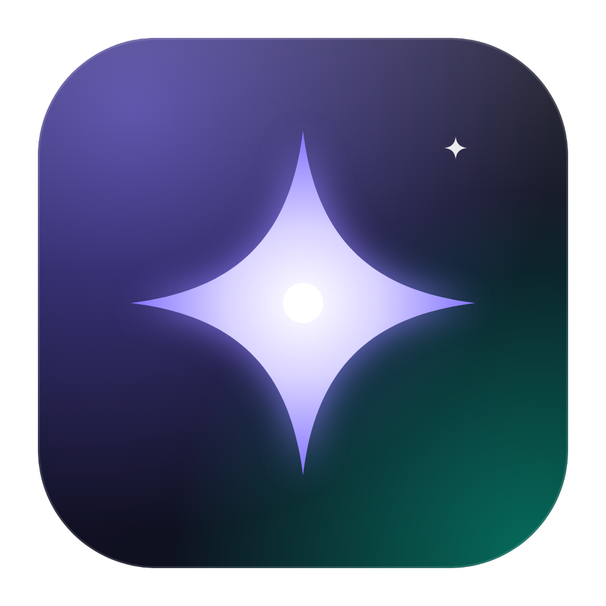
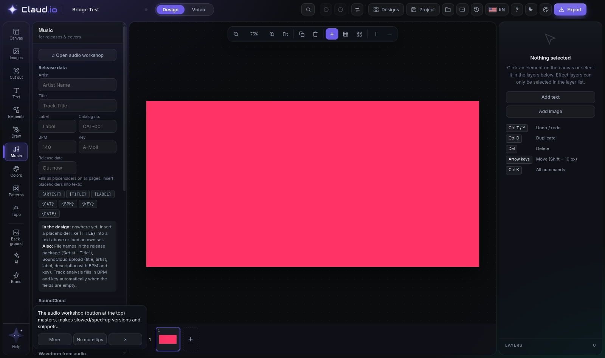
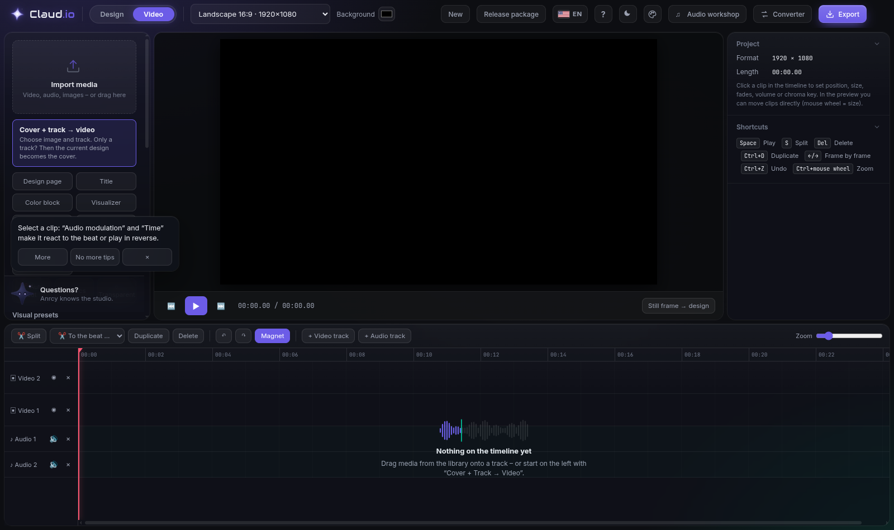

<div align="center">



# Claud.io

**Design, video, audio-reactive visuals and 3D in one studio.**
Created by **ANRCY**.

[Download for Windows](https://github.com/GPTmadeit/claud.io/releases/latest) · [Release notes](https://github.com/GPTmadeit/claud.io/releases)



</div>

## What it is

Claud.io is a desktop creative studio for musicians and visual artists:

- **Design**: covers, banners, logos and social formats with layers, pages, typography, patterns, topographic maps, brand kits and an image lab.
- **Video**: a multi-track timeline with clips, transitions, keyframes, beat-synced cuts, lyrics, and MP4/WebM export.
- **Audio-reactive visuals**: kick, snare, hi-hat, bass, sub-bass, mids, presence, transients, stereo width and loudness drive 35 visualizer styles, 30 shader generators, video effects and a modulation matrix (threshold, curve, attack/release, range, profiles). Optional live microphone/line-in input.
- **3D studio**: 47 object types, 3D text, materials, lighting, up to six independent orbit systems (circle, ellipse, atom, swarm, spiral, helix, figure eight, Lissajous, irregular) with per-companion editing, camera moves, and animated 3D clips for the timeline.
- **Motion design**: keyframes with ten easing curves, custom Bezier, per-key easing, loop and ping-pong, reverse, offset, copy/paste, and motion presets.
- **Audio workshop and converter**: mastering, slowed/sped-up versions, snippets and file conversion.

Everything runs locally. Your projects stay on your computer.



## Install (Windows 10/11, 64-bit)

| File | What it is |
|---|---|
| `Claud.io-Setup-x.y.z.exe` | **Recommended.** Installer with Start menu and desktop shortcuts. Updates itself. |
| `Claud.io-x.y.z-Portable.exe` | Runs without installing (for example from a USB stick). Does not update itself. |

1. Download `Claud.io-Setup-x.y.z.exe` from the [latest release](https://github.com/GPTmadeit/claud.io/releases/latest).
2. Run it. The installer is not code-signed yet, so Windows SmartScreen may show "Windows protected your PC". Click **More info → Run anyway**.
3. Start **Claud.io** from the Start menu. Double-clicking a `.studio` project file opens it in Claud.io.

## Updates

The installed app checks GitHub Releases at start and every few hours. New versions download in the background; a **Update ready** button appears in the top bar, and the update installs when you restart (or the next time you quit). You can also check by hand: click the Claud.io logo, then **Check for updates**.

## Offline use

The libraries the studio loads on demand (three.js, jsPDF, mp4box, paper.js and others) ship inside the app. Google Fonts and other web resources are cached after their first use. A few features still need the internet: AI background removal and upscaling (model download), ffmpeg-based conversion, the AI assistant, map elevation data and the SoundCloud bridge.

## Tips

- `Ctrl+K` searches every command. `F1` opens Anrcy, the built-in help.
- Appearance (palette icon in the top bar): dark, light, eye-friendly or system mode, accent colours, surface style (**Glass**, Smooth or Grain), contrast, density, interface size, interface motion (Full, Subtle, Reduced, Off) and saved appearance profiles. Choose Smooth on older graphics cards.
- Workspaces: Design, Video, Audio & visualizer, 3D, Minimal and Advanced presets, or save your own. Drag panel edges to resize them; double-click the left edge to collapse it.
- Star commands in `Ctrl+K` to pin them to the top.
- Click the logo to see whether hardware acceleration is active. It is on by default; turn it off there only if 3D or video looks broken.
- English and German: the flag button in the top bar switches the language.
- `F11` toggles full screen. `Ctrl+Shift+I` opens developer tools (useful for bug reports).

## Building from source

The whole studio is one self-contained HTML file, `app/index.html`. The desktop shell is Electron.

```bash
npm install
npm run vendor     # download the bundled CDN libraries into vendor/
npm start          # run the desktop app
npm run dist:win   # build the installer and portable exe into dist/ (on Windows)
```

`app/index.html` also opens directly in Chrome or Edge.

### Releasing

1. Bump `version` in `package.json` and run `npm run version:sync`.
2. Add `release-notes/vX.Y.Z.md`.
3. Commit, then push a tag `vX.Y.Z`. The GitHub Actions workflow builds on Windows, publishes the installer, the portable exe, `latest.yml` (the update feed) and SHA-256 checksums, and applies the release notes.

## Credits

Claud.io is created by **ANRCY**.
Built with [Electron](https://www.electronjs.org/), [three.js](https://threejs.org/), [mp4-muxer](https://github.com/Vanilagy/mp4-muxer) and other open-source libraries credited in the source.
